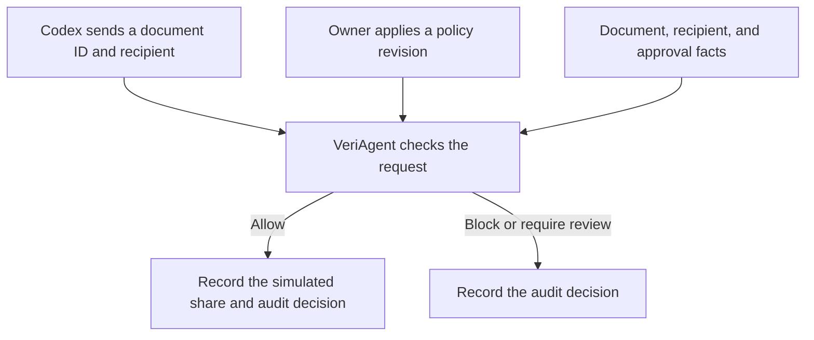

# VeriAgent

**Owner-controlled document sharing for Codex.**

VeriAgent pairs a Windows policy editor with a local Model Context Protocol (MCP) server. When Codex asks the server to share a document, VeriAgent checks the owner's rules before recording a simulated share.

## Motivation

A request to share a document tells an agent what to do. Whether it should go through depends on who will receive the document, how it is classified, and whether that particular share has been approved. VeriAgent gives the owner a way to turn those requirements into rules the sharing tool enforces on every request.

## How it works



1. **The owner sets the rules.** The desktop companion shows each rule in plain language and Boolean form. The owner can preview how a rule change affects a sample request and review the changes before applying them. Applying the changes creates a new policy revision that takes effect for subsequent tool calls.
2. **Codex requests a share.** Codex calls `share_document` with a document ID and recipient. The server reads the active policy when the call starts. It determines whether the recipient is external and uses local records to check the document's classification and whether that document has been approved for that recipient.
3. **VeriAgent makes the decision.** A SAT solver checks which Boolean rule conditions match the facts. A matching block takes precedence over review, and review takes precedence over allow. If required facts are missing or no rule matches, the server returns a review-required decision.
4. **The server records the outcome.** Only an allowed request writes a simulated share to the SQLite outbox. The server writes it in the same transaction as the audit record. The companion's Activity view shows the policy revision, the facts used, the matched rules, and whether the share executed.

## Quick start

Requires Windows, Python 3.11 or later, and PowerShell. Run from the repository root:

```powershell
python -m venv .venv
.\.venv\Scripts\python.exe -m pip install -r requirements-desktop.txt
.\.venv\Scripts\python.exe -m veriagent.desktop --home .demo-state
```

The companion opens with an empty catalog and policy workspace. Use Rules to author a policy and Review/Apply to activate a revision. Connection / State shows the selected state directory and the command for registering the local server with Codex. The companion and server must use the same directory. [Desktop guide](docs/desktop.md)

## Scope

Sharing is simulated: an allowed request writes a SQLite outbox record; it does not deliver a document. Enforcement covers calls routed through VeriAgent. `HUMAN_REVIEW` pauses execution; interactive approval and resume are not implemented.

This checkout includes the application source and tests. The sample seed-policy file is not included, so sample initialization requires that additional input. You can open the empty companion and run the checks below without it.

## Tests

```powershell
.\.venv\Scripts\python.exe -m pytest -q -rs
```

Tests that need absent fixture files report explicit skips. To run only the real MCP check for an empty catalog and a request that cannot execute:

```powershell
.\.venv\Scripts\python.exe -m pytest tests/test_empty_state.py -q
```

## Project layout

| Path | Contents |
|---|---|
| `veriagent/` | Desktop companion, MCP server, policy checking, and local state |
| `prompts/` | Policy-authoring prompt and candidate schema |
| `tests/` | Application tests |
| `examples/demo.py` | Three-outcome MCP demo; requires the seed-policy input |
| `packaging/` | Desktop and server entry points |
| `docs/` | Desktop usage, attribution, and dependency notices |

## Background and license

VeriAgent grew out of exploring VeriTrans's approach to language-to-logic translation and symbolic checking. [Attribution](docs/attribution.md)

Original code is available under the [MIT license](LICENSE). Dependencies retain their own licenses and notices. [Third-party notices](docs/third-party-notices.md)
